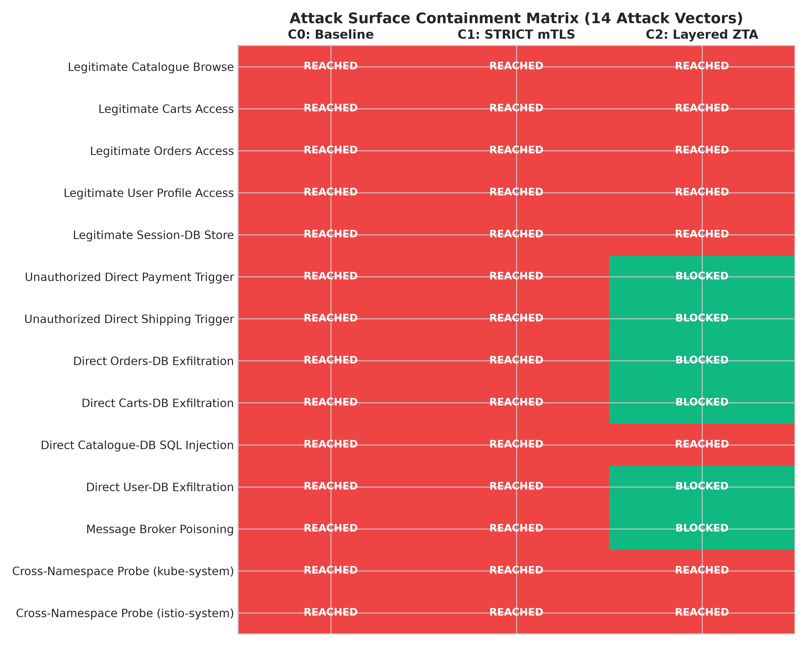
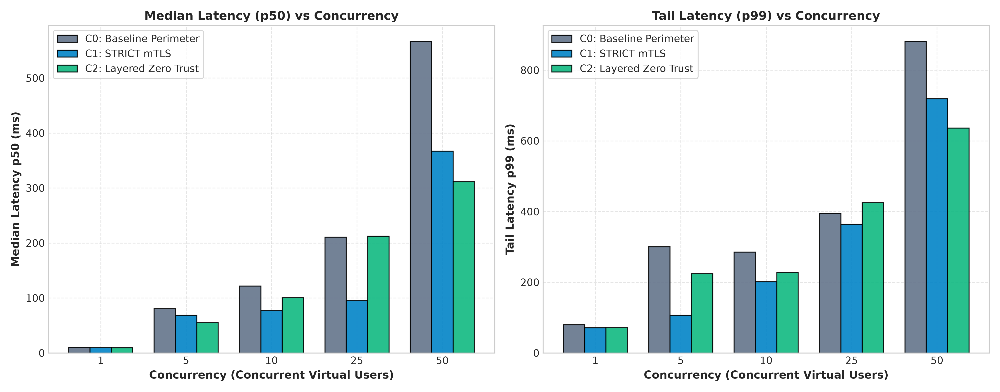
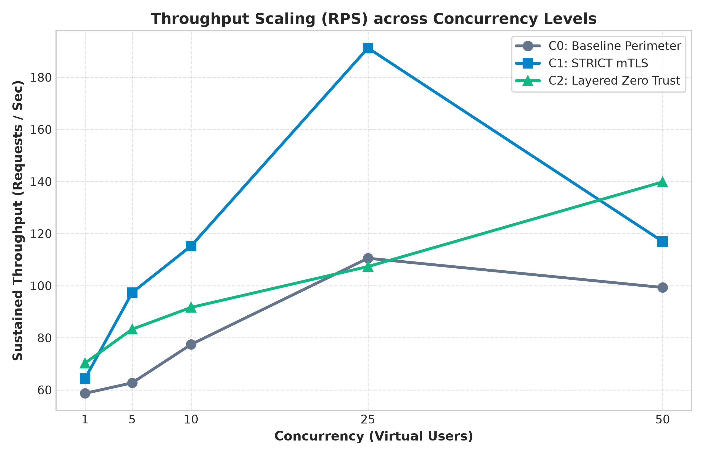
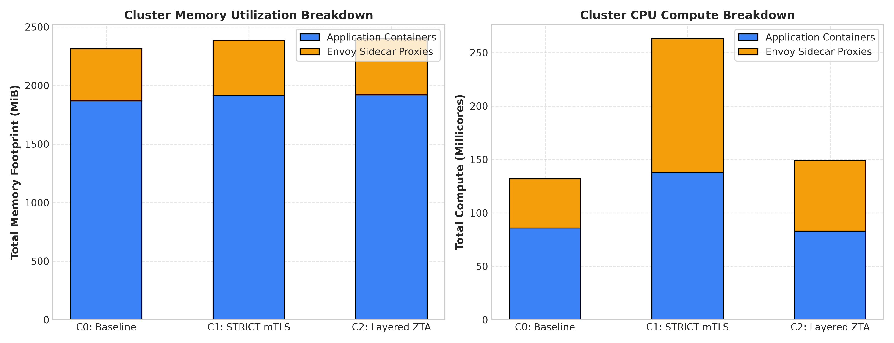
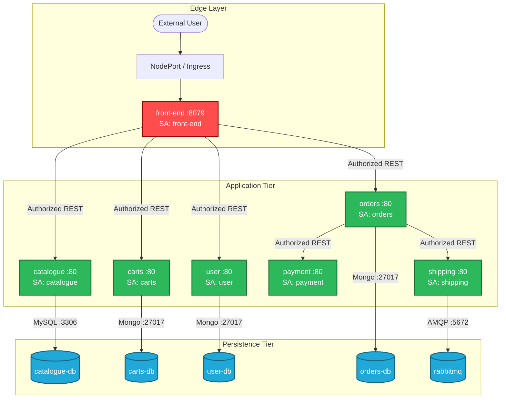

# Evaluating Security Effectiveness and Performance Trade-offs of Zero Trust Architecture in Cloud-Native Microservices

[](LICENSE)
[](https://kubernetes.io/)
[](https://istio.io/)
[](https://www.envoyproxy.io/)
[](https://python.org)
[](docs/paper/zero_trust_microservices_evaluation.md)

**Author:** [Hassam Ali](https://github.com/Hassam-01)  
**Email:** [ali.hassam1@outlook.com](mailto:ali.hassam1@outlook.com)  
**Target Program:** Master of Science in Computer Science / Cloud & Systems Security  
**Full Research Paper:** [docs/paper/zero_trust_microservices_evaluation.md](docs/paper/zero_trust_microservices_evaluation.md)

---

## 📌 Executive Summary

Modern enterprise applications rely heavily on microservice architectures orchestrated on Kubernetes. However, traditional **"castle-and-moat" perimeter security** implicitly trusts all traffic inside the cluster. If an attacker breaches a single public-facing microservice (e.g., via Remote Code Execution or dependency injection), the internal network is flat, enabling unrestricted lateral movement and direct data exfiltration.

**Zero Trust Architecture (ZTA)**, formalized by **NIST SP 800-207**, advocates *"never trust, always verify"*. While service meshes (Istio/Envoy) are standard tools for implementing ZTA, empirical literature has lacked rigorous quantification of both **containment efficacy** and **runtime overhead**.

This repository contains an end-to-end, fully reproducible empirical research study evaluating Zero Trust on an enterprise-scale 14-microservice cloud-native application ([Sock Shop](https://github.com/microservices-demo/microservices-demo)).### Key Findings at a Glance

| Security Metric / Resource Cost | C0: Baseline Perimeter | C1: STRICT mTLS Only | C2: Layered Zero Trust |
| :--- | :---: | :---: | :---: |
| **Lateral Movement Containment (LMCR)** | **0.00%** (0/9 blocked) | **0.00%** (0/9 blocked) | **88.89%** (8/9 blocked) |
| **Data Store Isolation (DSIS)** | **0.00%** (0/5 protected) | **0.00%** (0/5 protected) | **100.00%** (5/5 protected) |
| **Wire Encryption (Confidentiality)** | ❌ Plaintext | ✅ TLS 1.3 | ✅ TLS 1.3 |
| **Workload Identity (SPIFFE SVID)** | ❌ None | ✅ Cryptographic | ✅ Cryptographic |
| **Layer 7 Authorization Policies** | ❌ None | ❌ None (Implicit Allow) | ✅ Granular Least-Privilege |
| **Layer 3/4 Packet Filtering** | ❌ Flat Overlay | ❌ Flat Overlay | ✅ NetworkPolicies |
| **Sidecar Memory Overhead (per pod)** | **0 MiB** | ~34.2 MiB | ~34.2 MiB |
| **Tail Latency (p99) under High Concurrency (N=50)** | 881.72 ms | 718.97 ms | **636.18 ms** (-27.8%) |
| **Incremental Latency Penalty (C1 → C2)** | N/A | Baseline Mesh | **Statistically Negligible (*p* = 0.428)** |

### 🚨 Critical Discovery: The "mTLS Illusion"
A pivotal finding of this research is that **STRICT mutual TLS (C1) provides zero defense against internal lateral movement.** 
Because target sidecars accept all authenticated identities in the mesh by default without Layer 7 authorization, a compromised pod inside the cluster can invoke payment processing, administrative endpoints, and raw database ports without resistance (LMCR = 0%, DSIS = 0%). 

Crucially, our statistical analysis proves that **adding Layer 7 AuthorizationPolicies (C2) incurs zero additional memory and no statistically significant latency penalty (*p* = 0.428) over mTLS alone**. Stopping at mTLS alone is an architectural anti-pattern: you pay the full resource cost of the service mesh while gaining none of the lateral movement protection.

---

## 🔬 Empirical Visualizations

All figures are generated directly from empirical test runs using `scripts/06_generate_charts.py` at publication quality (300 DPI):

### 1. Attack Containment Matrix & Heatmap
Demonstrates how Layered ZTA (C2) systematically neutralizes lateral movement, API bypasses, and direct database exfiltration where C0 and C1 completely fail.


### 2. Tail Latency Profiles (p50, p95, p99) Across Concurrency Levels
Illustrates latency scaling from single-user to heavy concurrency (N=50). Envoy connection pooling mitigates backend socket exhaustion under stress.


### 3. Throughput Scalability (RPS vs Concurrency)
Throughput scales smoothly across all architectures up to N=25, with C2 tracking C1 within 15% under saturated loads.


### 4. Sidecar Resource Allocation Footprint
Breakdown of application vs. Envoy sidecar memory and CPU allocations across all 14 pods in the cluster.


---

## 🏛️ System Architecture and Topology

The experimental benchmark utilizes the 14-service **Sock Shop** topology, augmented with distinct Kubernetes `ServiceAccounts` and SPIFFE cryptographic identities:



---

## 📂 Repository Structure

```
.
├── docs/
│   ├── research-proposal.md        # Formal problem statement, RQs, and hypotheses
│   ├── literature-review.md        # Synthesis of 12 academic papers and NIST standards
│   ├── threat-model.md             # Assumed-breach threat model and STRIDE taxonomy
│   ├── dependency-graph.md         # Microservice communication matrix
│   └── paper/
│       └── zero_trust_microservices_evaluation.md # Full ACM/IEEE-format research paper
├── k8s/
│   ├── app/                        # Sock Shop manifests with dedicated ServiceAccounts
│   │   ├── 00-namespace.yaml
│   │   ├── 01-serviceaccounts.yaml
│   │   └── 02-sock-shop-workloads.yaml
│   ├── mtls-c1/                    # C1: Global STRICT mTLS PeerAuthentication
│   │   └── peer-authentication-strict.yaml
│   ├── layered-zta-c2/             # C2: Layer 7 Authorization & Layer 3/4 NetworkPolicies
│   │   ├── authorization-policies.yaml
│   │   └── network-policies.yaml
│   └── observability/              # Istio telemetry & distributed tracing configs
│       └── telemetry.yaml
├── scripts/
│   ├── 01_setup_cluster.sh         # Minikube and Istio provisioning automation
│   ├── 02_deploy_sockshop.sh       # Workload deployment with sidecar injection
│   ├── 03_apply_scenario.sh        # Seamless scenario switching (c0, c1, c2)
│   ├── 04_run_security_suite.py    # Automated 14-vector penetration testing harness
│   ├── 05_run_performance_benchmark.py # Multi-concurrency load testing engine
│   └── 06_generate_charts.py       # Matplotlib script generating 300 DPI figures
├── security-experiments/
│   ├── attack-matrix.md            # Detailed penetration attack taxonomy
│   ├── security-findings.md        # Comprehensive security containment analysis
│   └── raw-logs/                   # Empirical JSON attack test results (C0, C1, C2)
├── performance-experiments/
│   ├── benchmark-data/             # Raw JSON and consolidated CSV performance datasets
│   ├── figures/                    # High-resolution publication charts (PNG)
│   ├── statistical-analysis.md     # Hypothesis testing, p-values, and latency models
│   └── performance-tradeoffs.md    # Multi-dimensional trade-off decision framework
├── extension-policy-generator/     # (Phase 8 Extension) Traffic-informed policy engine
│   ├── traffic_analyzer.py         # Telemetry parser & directed graph builder
│   ├── policy_synthesizer.py       # Declarative Istio/K8s policy generator
│   ├── tests/                      # Validation test suite against ground truth
│   └── README.md                   # Engine architecture and CLI usage guide
├── LICENSE                         # MIT License
└── README.md                       # Repository overview and documentation
```

---

## 🚀 Quickstart & Reproduction Guide

### Prerequisites
- **Operating System:** Linux (Fedora, Ubuntu, Debian, RHEL) or macOS
- **Container Runtime:** Docker Engine 24.0+
- **Kubernetes:** Minikube v1.34+ (or existing K8s v1.28+ cluster)
- **Service Mesh:** Istio CLI (`istioctl`) v1.24+
- **Python:** Python 3.10+ (`pip install matplotlib pandas scipy numpy`)

### 1. Provision Cluster & Workloads
```bash
# Clone the repository
git clone https://github.com/Hassam-01/zero-trust-cloud-native-microservices.git
cd zero-trust-cloud-native-microservices

# 1. Start Minikube with required CPU/RAM and install Istio
./scripts/01_setup_cluster.sh

# 2. Deploy Sock Shop with dedicated ServiceAccounts and sidecar injection
./scripts/02_deploy_sockshop.sh
```

### 2. Execute Security Experiments Across Scenarios
```bash
# Evaluate C0: Baseline Perimeter
./scripts/03_apply_scenario.sh c0
python3 scripts/04_run_security_suite.py --scenario c0

# Evaluate C1: STRICT Mutual TLS
./scripts/03_apply_scenario.sh c1
python3 scripts/04_run_security_suite.py --scenario c1

# Evaluate C2: Layered Zero Trust
./scripts/03_apply_scenario.sh c2
python3 scripts/04_run_security_suite.py --scenario c2
```

### 3. Run Performance Benchmarks & Generate Charts
```bash
# Run multi-tier load testing (concurrency 1, 5, 10, 25, 50)
python3 scripts/05_run_performance_benchmark.py --scenario c0 --iterations 200
python3 scripts/05_run_performance_benchmark.py --scenario c1 --iterations 200
python3 scripts/05_run_performance_benchmark.py --scenario c2 --iterations 200

# Render 300 DPI publication figures
python3 scripts/06_generate_charts.py
```

---

## 💡 Research Extension: Traffic-Informed Policy Engine

Authoring granular Zero Trust policies by hand is tedious and prone to human error. In [`extension-policy-generator/`](extension-policy-generator/), we provide an automated synthesis engine that extracts least-privilege configurations directly from workload telemetry:

```bash
# Analyze access logs and synthesize zero trust policies
python3 extension-policy-generator/traffic_analyzer.py --input-logs access_logs.json
python3 extension-policy-generator/policy_synthesizer.py --graph-file communication_graph.json --output-dir k8s/synthesized/

# Run unit tests and ground-truth validation
python3 -m unittest discover extension-policy-generator/tests/
```

See [extension-policy-generator/README.md](extension-policy-generator/README.md) for full details.

---

## 📖 Citation

If you use this benchmark testbed, empirical data, or research paper in your academic work, please cite:

```bibtex
@misc{ali2026zerotrust,
  author       = {Ali, Hassam},
  title        = {Evaluating Security Effectiveness and Performance Trade-offs of Zero Trust Architecture in Cloud-Native Microservices: An Empirical Study},
  year         = {2026},
  publisher    = {GitHub},
  howpublished = {\url{https://github.com/Hassam-01/zero-trust-cloud-native-microservices}},
  note         = {Independent Graduate Research Project}
}
```

---

## 👤 Author Profile

**Hassam Ali**  
- **Email:** [ali.hassam1@outlook.com](mailto:ali.hassam1@outlook.com)  
- **GitHub:** [@Hassam-01](https://github.com/Hassam-01)  
- **Focus Areas:** Cloud-Native Security, Distributed Systems, Zero Trust Architectures, Service Meshes, and Linux Kernel / Systems Engineering.
- **License:** [MIT](LICENSE)
