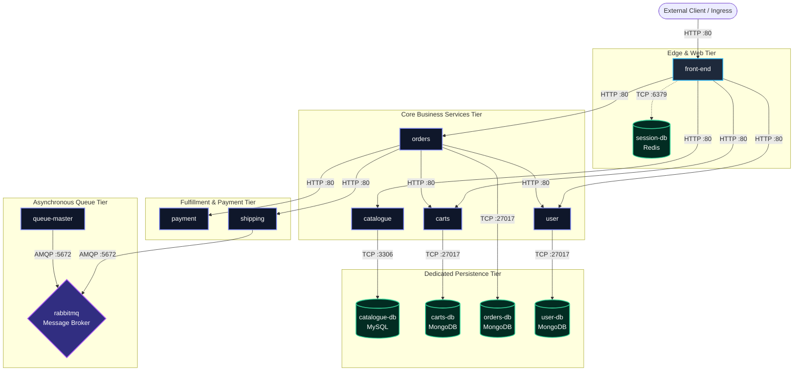

# Legitimate Inter-Service Dependency Graph: Sock Shop Microservices

**Author:** Hassam Ali  
**Project:** Evaluating Security Effectiveness and Performance Trade-offs of Zero Trust in Cloud-Native Microservices  
**Date:** October 2026  

---

## 1. Architectural Topology Overview

The Sock Shop microservice benchmark represents a canonical enterprise e-commerce platform decomposed into 14 distinct microservices and dedicated state stores. 

Under the principle of **Least Privilege (NIST SP 800-207 Tenet 6)**, every workload identity must be restricted to communicate strictly with its declared functional dependencies. All other inter-service paths represent unauthorized lateral movement potential.

---

## 2. Legitimate Communication Architecture (Mermaid Graph)

---

## 3. Comprehensive Service Dependency Matrix

The table below catalogs every legitimate communication path permitted within the Zero Trust policy matrix (C2).

| Caller Service (Source) | Source ServiceAccount | Callee Service (Destination) | Destination ServiceAccount | Port / Protocol | Allowed Endpoints / Paths | Business Justification |
| :--- | :--- | :--- | :--- | :--- | :--- | :--- |
| **Ingress Gateway** | `istio-ingressgateway-service-account` | `front-end` | `front-end` | 80 / HTTP | `/*` | External user access to storefront UI. |
| `front-end` | `front-end` | `catalogue` | `catalogue` | 80 / HTTP | `/catalogue*`, `/tags*` | Browse product items and categories. |
| `front-end` | `front-end` | `carts` | `carts` | 80 / HTTP | `/carts*`, `/items*` | Manage customer shopping basket. |
| `front-end` | `front-end` | `orders` | `orders` | 80 / HTTP | `/orders*` | View user order history and initiate checkout. |
| `front-end` | `front-end` | `user` | `user` | 80 / HTTP | `/login`, `/register`, `/customers*`, `/cards*`, `/addresses*` | User authentication and profile loading. |
| `front-end` | `front-end` | `session-db` | `session-db` | 6379 / TCP | Redis protocol | HTTP session persistence across requests. |
| `catalogue` | `catalogue` | `catalogue-db` | `catalogue-db` | 3306 / TCP | MySQL Wire Protocol | Query sock inventory and item details. |
| `carts` | `carts` | `carts-db` | `carts-db` | 27017 / TCP | MongoDB Wire Protocol | Persist active items in shopping carts. |
| `orders` | `orders` | `orders-db` | `orders-db` | 27017 / TCP | MongoDB Wire Protocol | Persist finalized customer orders. |
| `orders` | `orders` | `payment` | `payment` | 80 / HTTP | `/paymentAuth` | Authorize credit card payment for order. |
| `orders` | `orders` | `user` | `user` | 80 / HTTP | `/customers*`, `/addresses*`, `/cards*` | Fetch customer address & payment profile. |
| `orders` | `orders` | `carts` | `carts` | 80 / HTTP | `/carts*` | Retrieve cart contents & clear cart after order. |
| `orders` | `orders` | `shipping` | `shipping` | 80 / HTTP | `/shipping` | Dispatch shipment creation for paid order. |
| `shipping` | `shipping` | `rabbitmq` | `rabbitmq` | 5672 / TCP | AMQP Protocol | Publish shipping order events to queue. |
| `queue-master` | `queue-master` | `rabbitmq` | `rabbitmq` | 5672 / TCP | AMQP Protocol | Consume shipping order events from queue. |
| `user` | `user` | `user-db` | `user-db` | 27017 / TCP | MongoDB Wire Protocol | Persist customer profiles, hashed passwords, cards. |

---

## 4. Unauthorized (Illegitimate) Lateral Attack Paths

Any connection not listed in the matrix above is classified as **Unauthorized**. The table below highlights key lateral paths tested during security experiments:

| Attack Vector | Source Service | Target Service | Normal Relationship | Expected C0 (Perimeter) | Expected C1 (STRICT mTLS) | Expected C2 (Layered ZTA) |
| :--- | :--- | :--- | :--- | :---: | :---: | :---: |
| **Direct DB Exfiltration** | `front-end` | `orders-db` | **Forbidden** | 🔴 Connected (Open) | 🔴 Connected (Open) | 🟢 **BLOCKED (Drop/Denied)** |
| **Direct DB Exfiltration** | `front-end` | `carts-db` | **Forbidden** | 🔴 Connected (Open) | 🔴 Connected (Open) | 🟢 **BLOCKED (Drop/Denied)** |
| **Direct DB Exfiltration** | `front-end` | `catalogue-db` | **Forbidden** | 🔴 Connected (Open) | 🔴 Connected (Open) | 🟢 **BLOCKED (Drop/Denied)** |
| **Direct DB Exfiltration** | `front-end` | `user-db` | **Forbidden** | 🔴 Connected (Open) | 🔴 Connected (Open) | 🟢 **BLOCKED (Drop/Denied)** |
| **Bypass Order Logic** | `front-end` | `payment` | **Forbidden** | 🔴 Allowed (200 OK) | 🔴 Allowed (200 OK) | 🟢 **BLOCKED (403 Forbidden)** |
| **Bypass Order Logic** | `front-end` | `shipping` | **Forbidden** | 🔴 Allowed (200 OK) | 🔴 Allowed (200 OK) | 🟢 **BLOCKED (403 Forbidden)** |
| **Message Queue Poisoning** | `front-end` | `rabbitmq` | **Forbidden** | 🔴 Connected (Open) | 🔴 Connected (Open) | 🟢 **BLOCKED (Drop/Denied)** |
| **Cross-Service Query** | `catalogue` | `orders` | **Forbidden** | 🔴 Allowed (200 OK) | 🔴 Allowed (200 OK) | 🟢 **BLOCKED (403 Forbidden)** |
| **Cross-Database Query** | `catalogue` | `user-db` | **Forbidden** | 🔴 Connected (Open) | 🔴 Connected (Open) | 🟢 **BLOCKED (Drop/Denied)** |
| **Cluster API Probe** | `front-end` | `kube-apiserver` | **Forbidden** | 🔴 Accessible | 🔴 Accessible | 🟢 **BLOCKED / Confined** |
